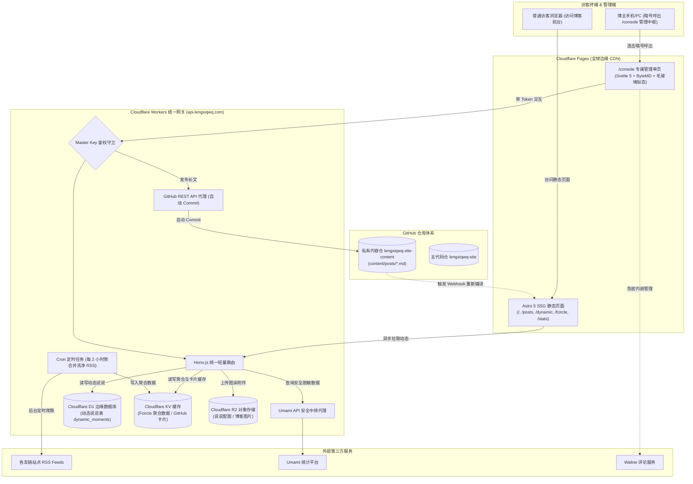
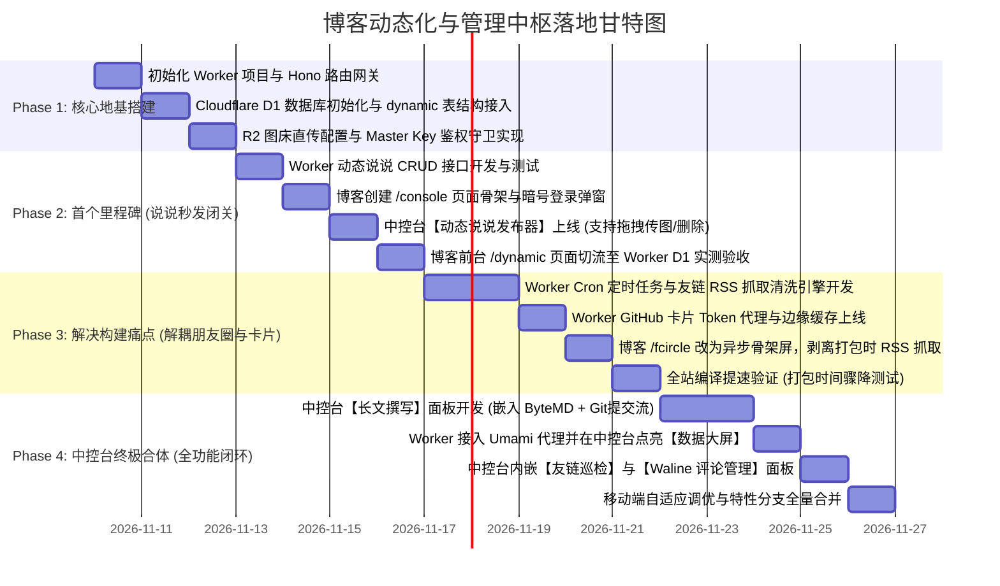

# 个人博客动态服务化与专属管理中枢（Console）实施规划书

> **文档版本**：v2.0.0  
> **制定日期**：2026-11-10  
> **适用工程**：`lengxiqwq-site`（主代码仓）与 `lengxiqwq-site-content`（私有内容仓）  
> **核心基础设施**：Cloudflare Pages / Workers / D1 / KV / R2（全托管无服务器架构）

---

## 目录
1. [系统整体演进蓝图与纯 Serverless 架构](#一-系统整体演进蓝图与纯-serverless-架构)
2. [核心模块技术选型与去中心化决策](#二-核心模块技术选型与去中心化决策)
3. [专属一体化管理中枢 (/console) 交互与功能架构](#三-专属一体化管理中枢-console-交互与功能架构)
4. [详细接口契约设计规范 (API Contracts)](#四-详细接口契约设计规范-api-contracts)
   - 4.1 动态说说与 R2 媒体 API (`/api/dynamic/*`)
   - 4.2 友链朋友圈聚合 API (`/api/fcircle/*`)
   - 4.3 访问统计安全代理 API (`/api/stats/*`)
   - 4.4 GitHub 仓库卡片实时数据 API (`/api/github/*`)
   - 4.5 管理端鉴权与文章自动 Commit API (`/api/admin/*`)
5. [分阶段实施路线图与时间线 (Phase 1 ~ Phase 4)](#五-分阶段实施路线图与时间线-phase-1--phase-4)
6. [Git 特性分支策略、双仓协同与开发规范 (SOP)](#六-git-特性分支策略双仓协同与开发规范-sop)
7. [前端容灾降级与防劣化机制](#七-前端容灾降级与防劣化机制)

---

## 一、 系统整体演进蓝图与纯 Serverless 架构

### 1.1 演进目标：彻底动静分离，消灭非必要构建
当前博客基于 Astro 5 构建，长篇技术博客采用纯静态生成（SSG）保证极致的 SEO 与首屏性能；而日常琐碎的动态需求（说说、统计、友链朋友圈、卡片）全面交由 **Cloudflare Workers + D1 + R2** 接管。

- **动态说说 (Moments)**：免除 Git 提交与 3 分钟 CI 打包，手机/网页直接写入 Cloudflare D1，前台 **0 秒刷新呈现**。
- **友链朋友圈 (Fcircle)**：从构建脚本剥离，由 Worker Cron 定时任务每 2 小时增量聚合写入 KV，前台异步分页拉取。
- **数据大屏 (Stats)**：Worker 代理并缓存 Umami 私密接口，安全呈现全站实时在线与月度趋势。
- **管理中枢 (Console)**：内置于博客内部的隐蔽驾驶舱，暗号呼出，集成写作、说说、统计、友链与评论管理。

### 1.2 目标系统拓扑图



---

## 二、 核心模块技术选型与去中心化决策

经过多轮评估，全面放弃第三方独立重型 CMS（如 Memos、Strapi），采用 **100% 纯 Cloudflare 免费边缘生态**：

| 模块 | 最终选型方案 | 为什么这么选？（核心优势） |
| :--- | :--- | :--- |
| **动态说说存储** | **Cloudflare D1 (SQLite)** | 每天免费 500 万次读取、10 万次写入，完全托管、零冷启动，0 维护成本。 |
| **说说图片存储** | **Cloudflare R2** | 每月 10GB 免费存储，**免出站流量费**，通过 Worker 15 行代码搞定极速直传。 |
| **友链朋友圈** | **Worker Cron + KV** | 抓取从全站构建解耦，避免外站超时卡死 CI；KV 全球边缘读取延迟 < 10ms。 |
| **访问统计大屏** | **Worker 代理 + KV 缓存** | 隐藏 Umami API Key；将实时人数（缓存15s）与历史趋势（缓存30m）冷热隔离。 |
| **管理后台界面** | **Astro 页面 + Svelte 5 自建中控台** | 零跳转、零多余域名；100% 继承 Firefly 玻璃质感；手机自适应好用。 |
| **长文博客编辑** | **中控台集成 ByteMD + GitHub API** | 掘金同款双向实时分屏；点保存自动向私有内容仓提 Commit，保留 Git 历史归档。 |

---

## 三、 专属一体化管理中枢 (/console) 交互与功能架构

### 3.1 隐秘入口与暗号鉴权
1. **呼出方式**：
   - 方式 A：在博客 Footer 的博主头像或特定标志上**快速连击 5 次**；
   - 方式 B：桌面键盘敲击组合热键 `Ctrl + Shift + K`；
   - 方式 C：直接访问隐蔽 URL（路径可在配置中自定义）。
2. **鉴权机制**：
   - 弹出毛玻璃质感密码卡片，输入博主主暗号（`Master Key`）；
   - Worker 校验通过后，签发带有过期时间的 JWT Token，存入本地 `sessionStorage`；
   - 7 天内免重复输入，支持随时右上角一键安全登出。

### 3.2 五大核心控制面板
- 💬 **【动态说说 (Moments)】**：
  - 微博/Twitter 式轻巧发布器，支持 `#话题` 与表情；
  - 拖拽/粘贴相册照片，直传 Cloudflare R2 并自动回填 WebP 链接；
  - 置顶切换与定位标签支持；
  - 下方已发布说说时间线，支持在线快速编辑文字或一键删除。
- 📝 **【长文写作 (Posts)】**：
  - 集成 ByteMD 分屏编辑器，支持 Markdown 语法、公式、代码高亮；
  - 侧边抽屉设置文章元数据（Frontmatter）：标题、分类、标签、自定义 Slug、封面图；
  - 本地自动暂存草稿，防止误关闭网页；
  - 点击【提交到 GitHub】：调用 Worker 自动 Commit 到内容仓，全自动触发上线。
- 📊 **【数据大屏 (Analytics)】**：
  - 呼吸绿灯显示“当前在线活跃访客数”；
  - 过去 30 天 PV 与 UV 走势折线图；
  - 热门阅读 Top 10 文章排行；
  - 访客来源国家、浏览器、操作系统占比。
- 🤝 **【友链中枢 (Friends)】**：
  - 复用现成友链审计逻辑，一眼查看哪些站点失联或未双向添加反链；
  - 【一键触发全网巡检】按钮：直接调用 GitHub Actions 运行测试脚本；
  - 快捷添加新友链表单。
- 💬 **【评论管理 (Comments)】**：
  - 免密内嵌现有 Waline 官方管理仪表盘；
  - 审核、删除垃圾广告、直接回复读者。

---

## 四、 详细接口契约设计规范 (API Contracts)

网关服务统一部署于：`https://api.lengxiqwq.com`（基于 Hono.js）

### 4.1 动态说说与 R2 媒体 API (`/api/dynamic/*`)

#### 接口 1：获取动态列表（公开只读）
- **路径**：`GET /api/dynamic/list?page=1&limit=20`
- **响应结构 (JSON)**：
```json
{
  "code": 200,
  "data": {
    "total": 56,
    "page": 1,
    "limit": 20,
    "items": [
      {
        "id": "m_1762701234",
        "content": "博客动态系统全面迁移到 Cloudflare Workers 啦！#日常",
        "images": [
          "https://img.lengxiqwq.com/dynamic/202611/pic1.webp"
        ],
        "pinned": true,
        "location": "上海",
        "createdAt": 1762701234000,
        "updatedAt": 1762701234000
      }
    ]
  }
}
```

#### 接口 2：发布说说（需 Master Token）
- **路径**：`POST /api/dynamic/publish`
- **请求头**：`Authorization: Bearer <JWT_TOKEN>`
- **请求体 (JSON)**：
```json
{
  "content": "今天拍到了一只好看的猫咪",
  "images": ["https://img.lengxiqwq.com/dynamic/202611/cat.webp"],
  "pinned": false,
  "location": "校园"
}
```

#### 接口 3：上传图片到 Cloudflare R2（需 Master Token）
- **路径**：`POST /api/dynamic/upload`
- **请求头**：`Authorization: Bearer <JWT_TOKEN>`，`Content-Type: multipart/form-data`
- **响应结构 (JSON)**：
```json
{
  "code": 200,
  "data": {
    "url": "https://img.lengxiqwq.com/dynamic/202611/upload_uuid.webp",
    "filename": "cat.webp",
    "size": 184320
  }
}
```

#### 接口 4：更新/删除说说（需 Master Token）
- **修改**：`PUT /api/dynamic/:id`
- **删除**：`DELETE /api/dynamic/:id`

---

### 4.2 友链朋友圈聚合 API (`/api/fcircle/*`)
- **获取文章**：`GET /api/fcircle/posts?page=1&limit=20`（KV 缓存 30 分钟）
- **获取统计**：`GET /api/fcircle/stats`

### 4.3 访问统计安全代理 API (`/api/stats/*`)
- **实时在线**：`GET /api/stats/realtime`（KV 缓存 15 秒）
- **30天大盘**：`GET /api/stats/summary`（KV 缓存 30 分钟）
- **热门文章与画像**：`GET /api/stats/insights`（KV 缓存 1 小时）

### 4.4 GitHub 仓库卡片实时数据 API (`/api/github/*`)
- **仓库详情**：`GET /api/github/repo?name=owner/repo`（带 PAT 请求，Cache API 缓存 2 小时）

### 4.5 管理端鉴权与文章自动 Commit API (`/api/admin/*`)
- **暗号登录**：`POST /api/admin/login`（传入 `masterKey`，校验成功返回 JWT）
- **长文提交**：`POST /api/admin/commit-post`
  - 参数：`{ title, slug, content, frontmatter }`
  - 逻辑：Worker 带着 GitHub Token 调用 GitHub API，向 `lengxiqwq-site-content` 仓库的 `content/posts/${slug}.md` 提交一次 Commit。

---

## 五、 分阶段实施路线图与时间线 (Phase 1 ~ Phase 4)

遵循**“先后端打地基，再前端出界面，交替推进，步步见效”**原则：



---

## 六、 Git 特性分支策略、双仓协同与开发规范 (SOP)

为保障开发过程 100% 安全、不污染现有线上主干，且充分利用 Cloudflare Pages 的多分支预览能力，制定如下开发规范：

### 6.1 分支策略与双仓协作辨析
1. **主代码仓 (`lengxiqwq-site`)**：
   - 本次改造属于功能、UI 组件与 API 对接，**所有代码修改全部发生在主代码仓**；
   - 创建专用特性分支：`feat/workers-and-console`；
   - **预览优势**：Cloudflare Pages 会自动为非 main 分支生成独立的**预览部署链接**（如 `https://feat-workers-and-console.lengxiqwq-site.pages.dev`），方便在手机和不同设备随时真机测试，完全不影响正在线上运行的正式站。
2. **私有内容仓 (`lengxiqwq-site-content`)**：
   - 保持在 `main` 分支稳定运行，**无需切分支**；
   - 无论是在本地 dev 还是在 Cloudflare Pages 预览构建中，脚本都会从内容仓的 `main` 分支拉取最新的真实文章数据，两者井水不犯河水，绝不冲突。

### 6.2 开发协同纪律（核心守则）
1. **本地开发服务保护**：
   - 用户在本地终端保持 `pnpm dev` 运行；
   - Agent 严禁执行 `kill`、`Stop-Process` 杀死 Node / Astro 进程；
   - Agent 严禁在本地执行 `pnpm build` 或清理缓存脚本（防止 Windows 下文件句柄锁定导致 `EPERM` 报错）；
   - 逻辑校验只使用纯内存的只读命令：`pnpm type-check`（`tsc --noEmit`）和 `pnpm lint`。
2. **Git 提交授权机制**：
   - 修改留在本地工作区供 HMR 毫秒级热更新，由用户在浏览器中直观体验；
   - 严禁擅自执行 `git commit` 或 `git push`；仅当一个阶段开发完毕、用户测试通过并明确说“提交”时，方可执行。
3. **完成合并机制**：
   - 当 Phase 1 ~ Phase 4 最终完成，且用户全量验收合格后，将 `feat/workers-and-console` 分支合入 `main` 分支，正式上线。

---

## 七、 前端容灾降级与防劣化机制

1. **接口熔断保底**：
   - 动态说说如果网络异常或 Worker 响应 5xx，前端展示友好的“暂无更新或信号稍弱，点击重试”卡片，不破坏整站骨架；
2. **GitHub 卡片三级兜底**：
   - 优先读取 `localStorage`；
   - 其次读取构建时硬编码的 `github-card-data.json`；
   - 异步尝试 Worker 接口，成功则静默刷新数值，失败则无感保留兜底数据。
3. **骨架屏防抖**：
   - `/fcircle` 与 `/dynamic` 首次加载均先渲染带脉冲动画的卡片占位，杜绝页面内容跳动（CLS 优化）。
