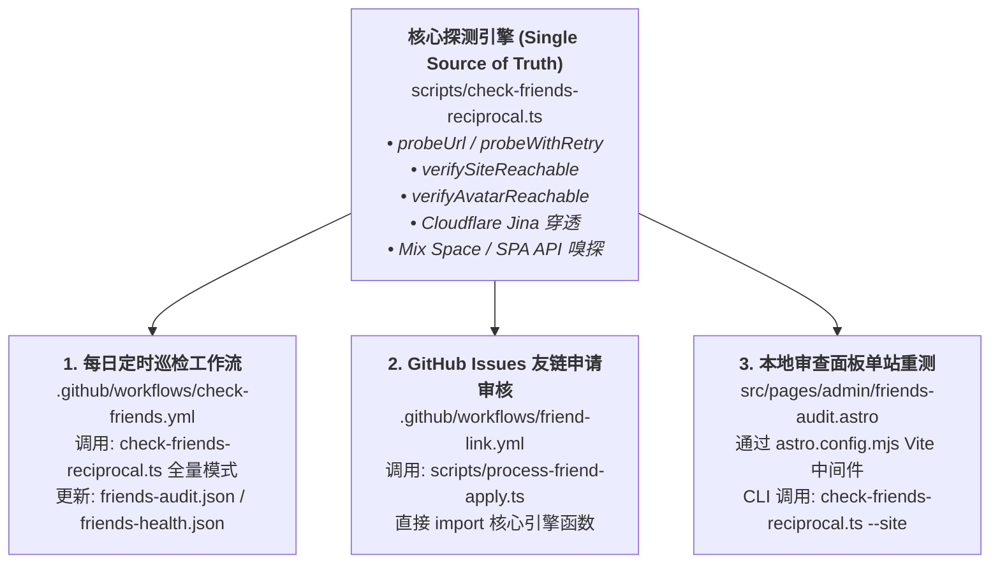

# 友情链接管理与智能爬虫系统架构与维护指南 (Friend Links Architecture & Guide)

> **面向 AI 助手与开发者的核心备忘**：  
> 本项目拥有完整的友情链接生命周期管理体系，包括**前台分类展示**、**本地后台审查面板**、**GitHub Actions 每日全网双向巡检**以及 **GitHub Issues 申请自动审核**。  
> **核心铁律**：全站所有网络探测与反爬穿透逻辑均收敛于单一核心模块，**严禁在其他地方手写重复的抓取逻辑**！改动 1 处必须确保 3 端同时生效。

---

## 1. 架构总览：单一事实源（Single Source of Truth）

全站所有友链相关的自动化任务，底层共享同一个爬虫与连通性探测引擎：



### 核心模块职责分工

| 模块 / 路径 | 角色与职责 | 维护规则 |
| :--- | :--- | :--- |
| [`scripts/check-friends-reciprocal.ts`](file:///d:/Projects/lengxiqwq-site/scripts/check-friends-reciprocal.ts) | **全局统一爬虫核心**：反爬伪装、WAF 穿透、动态 API 嗅探、分页遍历、主页/头像存活检测、单站/全量 CLI 入口。 | **核心大脑**：任何关于“怎么抓页面、怎么识别友链、怎么绕过反爬”的修改，**必须且仅在此文件修改**！ |
| [`scripts/process-friend-apply.ts`](file:///d:/Projects/lengxiqwq-site/scripts/process-friend-apply.ts) | **GitHub Issues 申请自动化处理**：负责解析 Issue Markdown 表单、格式验证、调用核心引擎核验、向 Issue 发送反馈评论、打标签、写入内容仓 `friendsConfig.ts`。 | **纯业务包装**：严禁在此编写网络探测代码，直接从 `check-friends-reciprocal.ts` 导入相关探测函数。 |
| [`astro.config.mjs`](file:///d:/Projects/lengxiqwq-site/astro.config.mjs) (`friendsAuditDevApiPlugin`) | **本地开发环境审查 API**：支持后台审查页面的单站现场重测（`probe-single`）、全站自检（`run-full-check`）、自定义友链目标地址更新。 | **精简调度层**：单站重测直接以子进程方式调度 `check-friends-reciprocal.ts --site "<siteurl>" --target "<targeturl>"`，杜绝维护重复逻辑。 |
| [`src/pages/admin/friends-audit.astro`](file:///d:/Projects/lengxiqwq-site/src/pages/admin/friends-audit.astro) | **站长管理审查台（前台页面）**：仅在本地开发环境可用（生产构建重定向 404）。提供友链健康状态指标、分类 Tab（双向正常 / 单向友链 / 失联隔离 / 免检白名单）、单站一键重测、裁决按钮。 | UI 与交互层，通过 `POST /api/friends-audit` 触发上述 Vite 插件。 |
| [`src/constants/friends-audit.json`](file:///d:/Projects/lengxiqwq-site/src/constants/friends-audit.json) | **友链双向性与健康度状态持久化文件**：记录每个站点的 `missingCount`、`failCount`、`protectedCount`、`lastStatus`、`decision`、`targetUrl` 等。 | 由探测引擎自动读写维护，支持自愈（Auto-healing）。 |

---

## 2. 爬虫底层探测机制（它是怎么检测的？）

为了保证极高的通过率并避免误杀正常网站，爬虫引擎设计了五层渐进式穿透机制：

### 第一层：安全防护与防 SSRF
- 针对申请者提供的 URL 执行严格检验，拦截 `localhost`、私有内网 IP 段（`127.*`、`10.*`、`192.168.*`、`172.16-31.*`）以及云元数据地址，防止针对 GitHub Actions 或本地开发机的 SSRF 探测攻击。

### 第二层：现代浏览器拟真与 Cloudflare / WAF 智能穿透
1. **浏览器标头拟真**：深度模拟桌面 Chrome 133 的 Client Hints（`sec-ch-ua`、`Sec-Fetch-Dest`、`Sec-Fetch-Mode` 等），规避普通 User-Agent 检测。
2. **机房 IP 阻断智能穿透（关键机制）**：
   - **痛点**：许多博主使用 Cloudflare 并开启了 Bot Fight Mode。GitHub Actions 运行在微软 Azure 机房 IP 上，访问会被 Cloudflare 自动拦截返回 `HTTP 403 / 503` 或弹出挑战盾（但在真实用户的家用宽带浏览器中访问是正常的 200）。
   - **穿透方案**：当探测遇到 `403`、`429`、`503` 或特征极小的 Cloudflare 验证页面（`<title>Just a moment...</title>`）时，爬虫自动降级调用只读渲染代理（`https://r.jina.ai/${targetUrl}`）穿透防火墙获取已渲染正文。

### 第三层：多重关键词与 URL 解码双向匹配
- 爬虫不仅检测原始 HTML 文本，还会执行 `decodeURIComponent`，以兼容中文站名在 HTML 属性中被百分号编码转义的情况。
- 匹配词库包括全系列本站标识：`lengxiqwq.com`、`冷汐的杂货铺`、`冷曦的小窝`、`lengxiqwq`、`lengxi`、`冷汐`、`冷曦`。

### 第四层：现代博客动态 API 深度穿透
面对单页应用（SPA）与客户端渲染站点，爬虫会自动进行二级动态 API 穿透：
1. **Mix Space / Shiro 主题专属嗅探**：
   - 现代很多博主使用 Next.js + Mix Space 架构，其友链数据不存放在首屏 HTML，而存放在独立后端的子域名接口（例如 `https://mix-space.xxx.com/api/v2/links`）。
   - 爬虫会自动从页面 HTML 中提取形如 `https://.../api/v2` 的跨域地址，并自动探测 `mix-space.${domain}/api/v2/links` 与 `api.${domain}/api/v2/links`。
2. **常见博客系统 API 矩阵遍历**：
   - 自动探测 `/api/x/get_friends/?cat=0/1/2`（如雨雪冰屋等主题的多分类接口）；
   - 自动探测 `/api-common/friend-link`（如 Kanako 小窝等 SPA 系统）；
   - 探测 `/api/friends`、`/api/links`、`/friends.json`、`/youlian.json` 等数十种主流接口。
3. **页面内脚本抓取**：自动正则提取页面 `<script>` 中的 `fetch(...)` 请求地址。

### 第五层：分页友链探测
- 针对一页只放少量友链、需要翻页的站点，爬虫自动识别包含 `page/2`、`下一页`、`Next` 等分页链接并深入抓取前 2 页。

### 连通性辅助探测：
- **站点主页检测（`verifySiteReachable`）**：检测主页存活性，若遇 403 同样接入 Jina 降级穿透。
- **头像链接检测（`verifyAvatarReachable`）**：对防盗链图片自动注入 `Referer: siteUrl` 进行重试；若头像位于自身域名下且遭遇机房 WAF 403 阻断，系统智能识别并包容。

---

## 3. 状态判定与自愈逻辑（Auto-healing）

持久化状态保存在 [`src/constants/friends-audit.json`](file:///d:/Projects/lengxiqwq-site/src/constants/friends-audit.json)：

```json
{
  "https://yukihime.dev/": {
    "missingCount": 0,
    "failCount": 0,
    "protectedCount": 0,
    "lastChecked": "2026-11-06T09:26:57.447Z",
    "lastStatus": "found",
    "lastMessage": "成功匹配关键词: \"lengxiqwq.com\" (https://yukihime.dev/friends/)",
    "targetUrl": "https://yukihime.dev/friends/",
    "decision": "normal"
  }
}
```

1. **自动累计与隔离**：
   - `missingCount`（未检测到反链）：连续 ≥3 次未检测到，状态自动变为 `pending`（单向告警）。
   - `failCount`（404 或网络故障）：连续 ≥3 次失效，状态自动变为 `pending`（失联告警）。
   - 站长可在审查台将站点裁决为 `single`（降级至底部“悄悄关注”区）、`quarantined`（移至“暂时失联”区）或 `whitelisted`（永久豁免免检）。
2. **自动自愈（Auto-healing）**：
   - 只要巡检或单站重测一旦重新 `found` 匹配到友链，系统会自动将 `missingCount`、`failCount`、`protectedCount` 全部清零！
   - 若此前处于 `pending`、`single` 或 `quarantined`，系统将**自动恢复其为 `normal`（双向正常）**，无需人工干预。

---

## 4. AI 维护与排查指南（Developer SOP）

### 黄金规则：改 1 处，3 处同时生效
- **切勿** 在 `astro.config.mjs` 中添加独立的探测代码；
- **切勿** 在 `process-friend-apply.ts` 中手写独立的 fetch / 请求逻辑；
- **只修改** [`scripts/check-friends-reciprocal.ts`](file:///d:/Projects/lengxiqwq-site/scripts/check-friends-reciprocal.ts)。

### 本地测试与调试命令

无论你在排查哪个站点的抓取问题，都可以使用以下纯只读、无副作用的 CLI 命令进行单站现场实测：

```bash
# 测试特定站点的友链反查与穿透结果（自动读取 targetUrl 并输出更新记录）
npx tsx scripts/check-friends-reciprocal.ts --site "https://yukihime.dev/"

# 指定特定目标页面进行实测
npx tsx scripts/check-friends-reciprocal.ts --site "https://www.hoshiroko.com" --target "https://hoshiroko.com/friends"

# 执行类型检查（确保修改没有语法与类型错误）
pnpm type-check

# 规范化代码格式
npx @biomejs/biome format --write scripts/check-friends-reciprocal.ts scripts/process-friend-apply.ts astro.config.mjs
```

### 排查新站点抓取不到的四步法：
1. **测试直接抓取**：用 `probeUrl(targetUrl, DEFAULT_KEYWORDS)` 测试 HTTP 状态码与正文。
2. **排查是否为反爬 403**：确认是否触发了 Jina 穿透 fallback。
3. **排查是否为现代 SPA / CMS**：查看该站的 Network 请求或 HTML 中的 `<script>`，确认它的友链 API 叫什么（如 `/api/v2/links`、`/api/links` 等），然后将其模式补入 `check-friends-reciprocal.ts` 的 `dynamicApis` 集合中。
4. **验证三端一致**：修改后在本地后台页面刷新并点击“重测”，确认即刻变绿。
